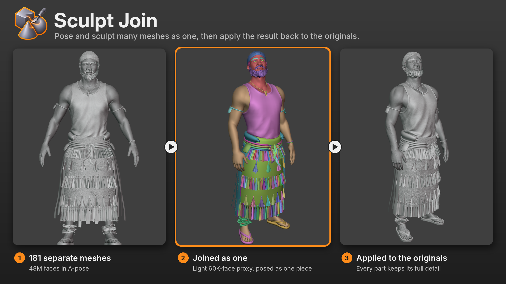
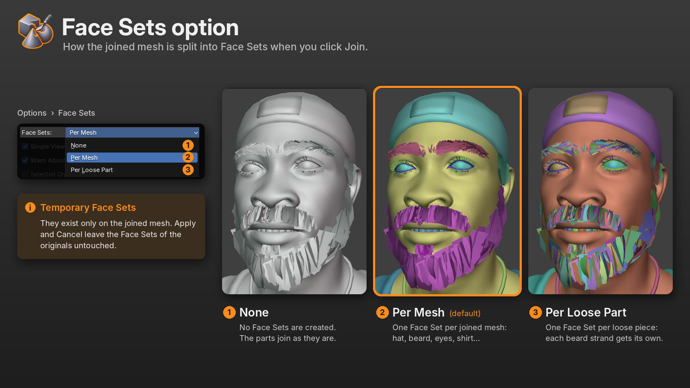
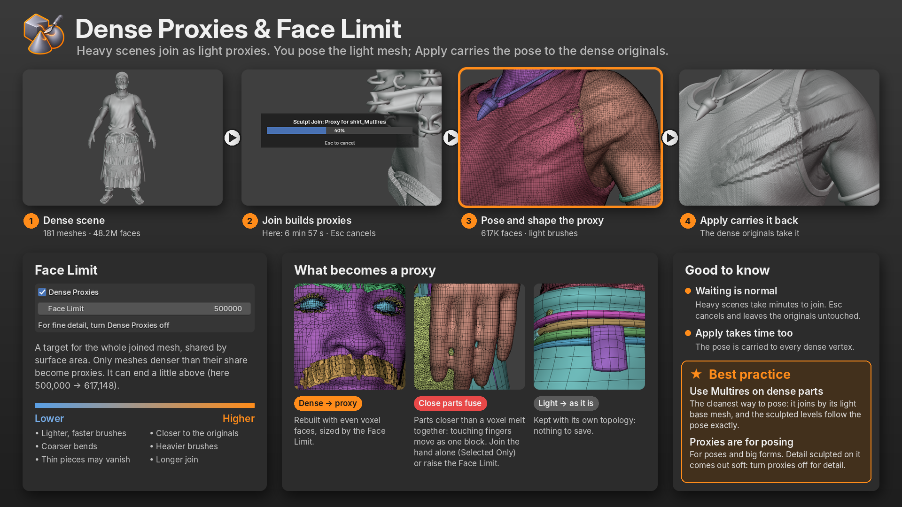
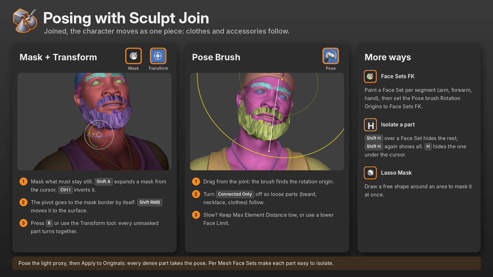
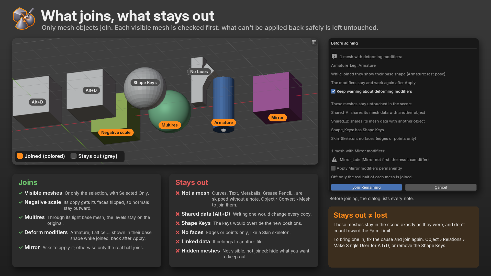
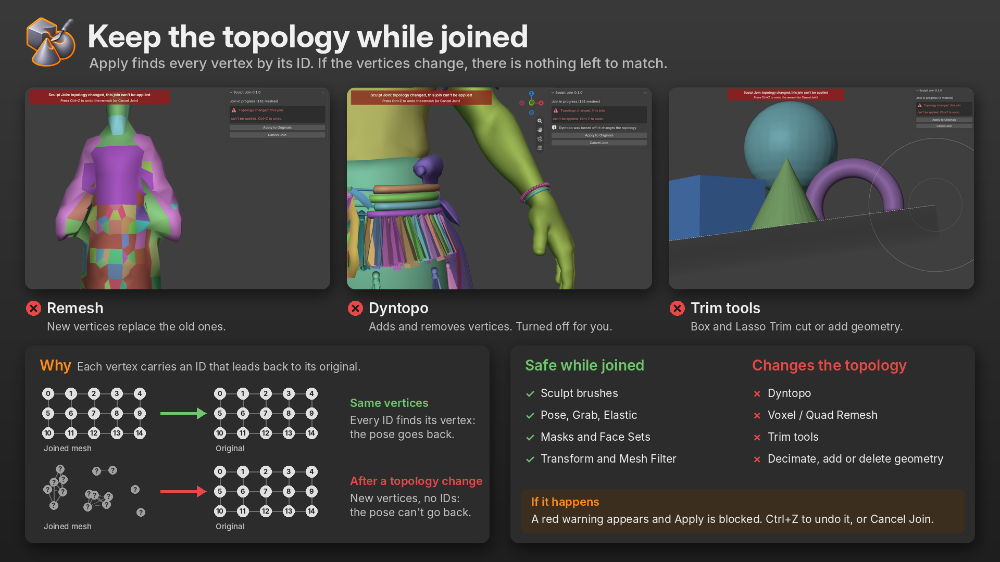

  

<h1 align="center">Sculpt Join</h1>

  <b>Join visible meshes to sculpt or pose them as one, then apply the result back to the originals.</b> 
  A free add-on for Blender 4.2 and newer.

A character is often many meshes: body, clothes, hair, accessories. Posing or reshaping them together means joining them, which destroys the separate objects, their modifiers and their settings.

Sculpt Join gives you the joined mesh without the cost. It joins **copies** of your meshes into one temporary object. You pose and sculpt it as a single piece, and **Apply to Originals** writes only the new vertex positions back into each original mesh. Names, origins, materials, UVs, modifiers (Multires included), Face Sets, parents and animation stay exactly as they were.

https://github.com/user-attachments/assets/df84e363-fd92-4fb4-a56e-3d9159ffe012

## Features

- **One click, non-destructive.** The originals are only hidden while you work. Cancel at any time and nothing has changed.
- **Heavy scenes stay light.** Dense meshes join as light proxies, and the pose is carried back to every vertex of the dense original. Tested on a scene with 181 meshes and 48 million faces.
- **Multires aware.** Meshes with Multires join by their light base mesh; the sculpted levels stay on the original and follow the pose.
- **Face Sets per mesh or per loose part,** so each part is easy to mask, hide or pose.
- **Mirror and negative scale handled.** Mirror modifiers can be applied on join, and objects with negative scale keep their normals pointing outward.
- **Safe by design.** Every step can be cancelled with Esc, a progress bar shows long operations, and the originals only change after a successful join or apply.

## Installation

**From Blender** (recommended): open *Edit › Preferences › Get Extensions*, search for **Sculpt Join** and click *Install*.

**From a file:** download `sculpt_join-0.1.0.zip` from the [Releases](https://github.com/hervert-ferreira/sculpt-join/releases) page, then in Blender use *Edit › Preferences › Get Extensions*, open the menu in the top-right corner and choose *Install from Disk*.

Requires Blender **4.2** or newer.

## How to use

1. Enter **Sculpt Mode** on any mesh and open the **Sculpt Join** tab in the sidebar (`N`).
2. Click **Join**. If some meshes need attention, a dialog lists them first.
3. Pose and sculpt the joined mesh as one piece.
4. Click **Apply to Originals** to send the result back, or **Cancel Join** to discard it.

If the joined mesh is deleted by accident, the panel offers **Restore Originals** to bring the hidden meshes back.

### Selected Only

By default every visible mesh is joined. Turn on **Selected Only** to join just the selected meshes plus the active one. Select the parts in the Outliner, or in Object Mode before entering Sculpt Mode.

https://github.com/user-attachments/assets/b6da409c-cdce-4267-8c78-80f23be0c078

## Options

| Option | What it does |
|---|---|
| **Dense Proxies** | When the scene has more faces than the Face Limit, dense meshes without Multires join as light proxies. On by default. |
| **Face Limit** | About how many faces the joined mesh should have (default 500,000). Shared by surface area; only meshes denser than their share become proxies. |
| **Face Sets** | *None*, *Per Mesh* (default) or *Per Loose Part*. Created on the joined mesh only. |
| **Single Viewport Color** | In Solid shading, shows the joined mesh in a single color while joined. Your materials are not changed. |
| **Warn About Deform Modifiers** | Before joining, lists meshes with Armature, Lattice and other deforming modifiers. |
| **Selected Only** | Joins only the selected meshes plus the active one. |

### Face Sets

The Face Sets exist only on the joined mesh. Apply and Cancel leave the Face Sets of the originals untouched.

### Dense Proxies and Face Limit

A proxy is a light copy rebuilt with even voxel faces. You pose the proxy; on Apply, every vertex of the dense original follows it.

- **Proxies are for posing and big forms.** Existing detail on the dense mesh is kept, but detail you sculpt on a proxy comes out soft. For fine detail, turn Dense Proxies off.
- **Lower Face Limit:** lighter, faster brushes, coarser bends. Thin pieces may vanish from the proxy.
- **Higher Face Limit:** closer to the originals, heavier brushes, longer join.
- **Parts closer than a voxel fuse in the proxy** (for example, touching fingers) and move as one. Join that part alone with Selected Only, or raise the Face Limit.
  
## Best practices

- **Use Multires on dense parts.** It is the cleanest way to pose: the part joins by its light base mesh and the sculpted levels follow the pose exactly. This only helps when the base mesh is light; a dense mesh without subdivision levels (a scan, an applied remesh) still needs a proxy.
- **Pose with proxies, detail without them.** Use Dense Proxies for poses and big shapes, and turn it off for fine sculpting.
- **New detail on a Multires part** sculpted while joined only carries the overall shape, since the part joins at its base level.
  
**Fine detail survives the pose.** In this example both the head and the cap have Multires. Each joins by its base mesh, and the brush reshapes both on the joined mesh. After Apply, the fine detail of both comes back: the scars and skin texture of the head, and the knit of the cap.

https://github.com/user-attachments/assets/35521dd8-3c7e-4498-bf4f-eaf6677ca1df

## Posing tips

- **Mask + Transform:** mask what must stay still (`Shift A` expands a mask, `Ctrl I` inverts it), then rotate with `R` or the Transform tool.
- **Pose Brush:** turn off *Connected Only* so loose parts (beard, necklace, clothes) follow.
- **Face Sets FK:** paint a Face Set per segment and set the Pose Brush *Rotation Origins* to *Face Sets FK*.
- **Isolate a part:** `Shift H` over a Face Set hides the rest; `Shift H` again shows everything.

## What joins, what stays out

**Joins:** visible mesh objects (or only the selected ones), including meshes with negative scale, Multires, deforming modifiers and Mirror modifiers.

**Stays out, untouched:**

- **Objects that are not meshes:** curves, text, metaballs, surfaces, Grease Pencil, volumes and so on are skipped without a note. Converting them with *Object › Convert › Mesh* lets them join, but the conversion is permanent: a converted curve is no longer a curve.
- **Shared mesh data (Alt+D):** writing one would change every copy. Use *Object › Relations › Make Single User* to join it.
- **Meshes with Shape Keys:** the keys would override the new positions.
- **Meshes without faces,** such as a Skin modifier skeleton.
- **Linked data** from another file.
- **Hidden meshes.**

Meshes with deforming modifiers (Armature, Lattice…) show their base shape while joined (Armature: the rest pose). The modifiers stay on the originals and work again after Apply.

## Keep the topology while joined

Apply finds every vertex by an ID written on it at join time. Anything that adds or removes vertices breaks that link:

- **Dyntopo** is turned off automatically while joined.
- **Remesh, Trim tools, Decimate** or adding and deleting geometry cannot be applied.

If it happens, a red warning appears and Apply is blocked. Press `Ctrl Z` to undo the change, or click **Cancel Join**.

## Known limitations

- Topology changes (Dyntopo, remesh, trim, decimate) cannot be applied: undo with `Ctrl Z` or cancel the join.
- With Dense Proxies and a low Face Limit, very thin pieces can vanish from the proxy.
- Fine detail sculpted on a proxy is not carried exactly to the dense mesh.
- Joining and applying with proxies takes time on very heavy scenes (several minutes for tens of millions of faces). A progress bar shows each step and `Esc` cancels.
- **Pose Brush with *Connected Only* off freezes for a few seconds on each stroke on large joined meshes.** This comes from Blender: it rebuilds the brush's "fake neighbors" for the whole mesh on every stroke and discards them at the end of the stroke. To ease it, lower the brush's *Max Element Distance* or use a lower Face Limit.

## Support

Found a bug or have an idea? Open an [issue](https://github.com/hervert-ferreira/sculpt-join/issues).

## License

Sculpt Join is free software, released under the [GNU General Public License v3.0 or later](LICENSE).
